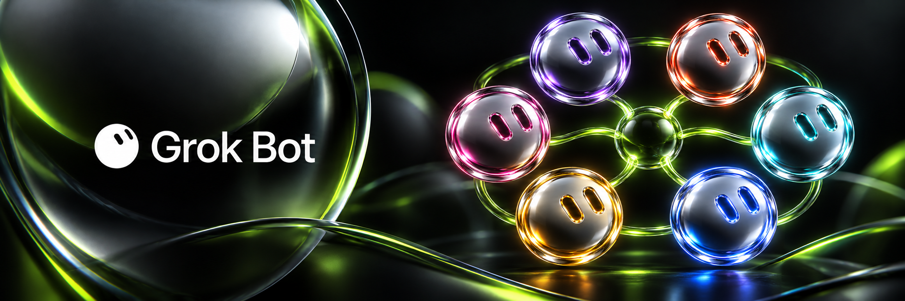
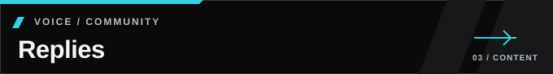
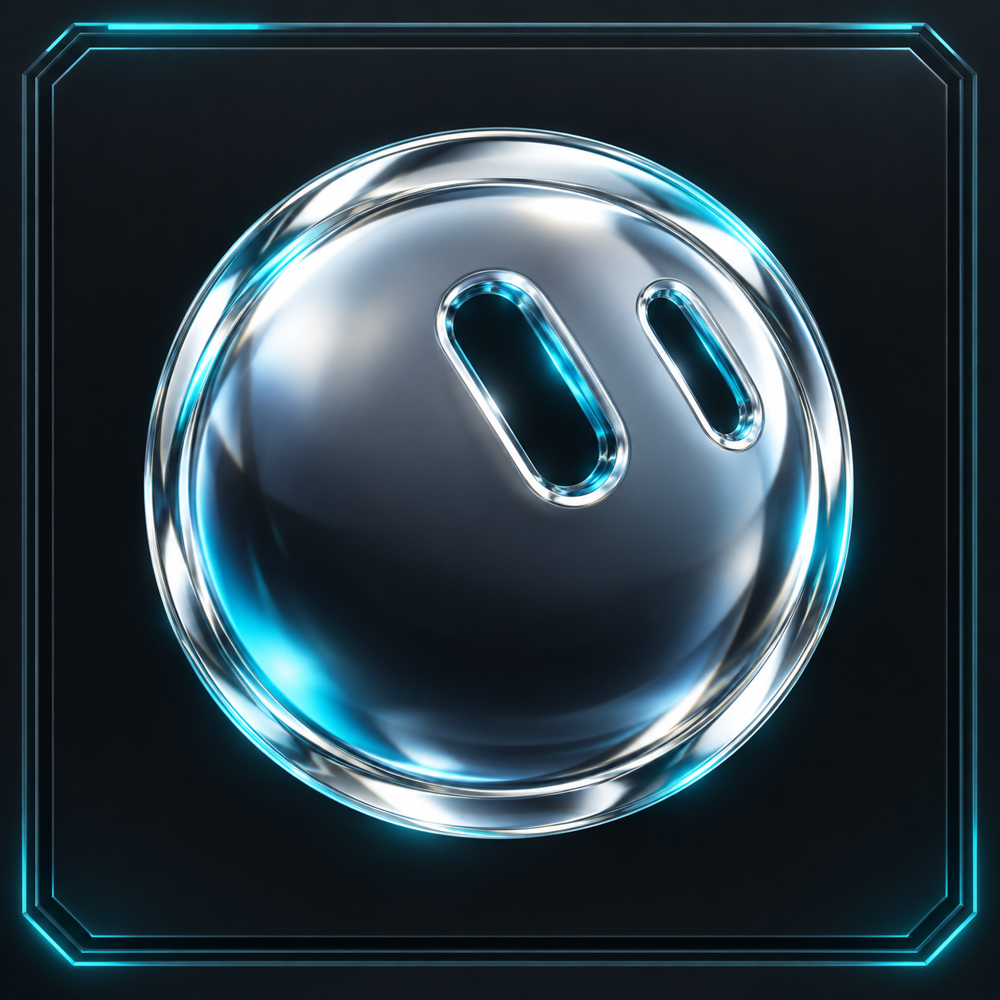
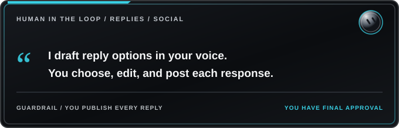
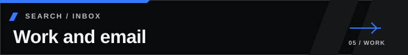
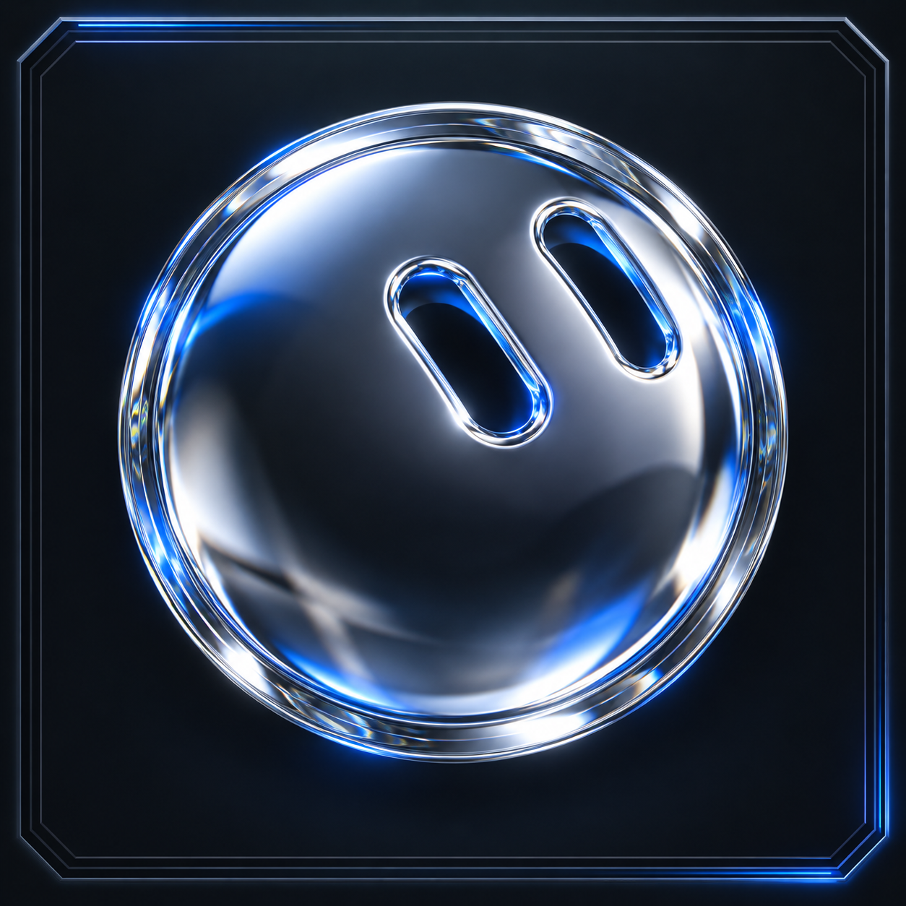
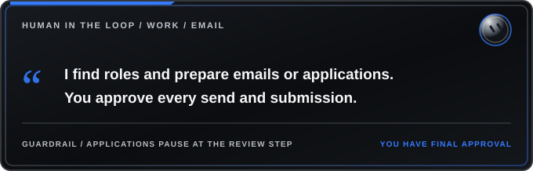

# Grok Bot Templates

An independent community collection of Grok Bot templates for solo creators and marketers. Use them as a full team, or pick just one.

**Independent community project:** This repository is not an official Grok Bot product and is not affiliated with, endorsed by, or sponsored by X, xAI, their affiliates, or the Grok Bot team. “Grok Bot,” its logos, and related marks belong to their respective rights holders. I do not claim ownership of Grok Bot or any associated intellectual property. I cannot provide support for the Grok Bot product; support here is limited to these community-authored templates.

**Approval-first workflow:** These templates tell each bot where to stop and bring consequential work to you for review. You retain final say over posts, replies, emails, and submissions. Review connected-tool permissions during setup; the cards describe the intended workflow, while permissions determine what a bot can technically do.

**Start with the templates:** [Content bots](#content-team) · [Work bots](#work-team) · [How they work together](#how-they-work-together) · [Using one alone](#how-each-works-alone)

<h2 id="content-team"> Content team</h2>

Four bots that build, schedule, and grow your social media presence. Post one message in the group chat and all four get it.

<table>
<tr>
<td width="50%" valign="top">
<h3 id="analytics-growth"></h3>

<em>Turn Account Insights into a Smarter Content Plan</em>

**What it does:** reviews your account's performance, finds what's working, and builds a posting plan with times and content types.

**Features:**
- Tracks analytics and growth strategy
- Daily reply targets and alerts
- Weekly engagement reports
- News watch and performance analysis

**Explore:** [Analytics and growth template](templates/analytics-and-growth.md)
</td>
<td width="50%" valign="top">
<h3 id="content-hunter"></h3>

<em>Find and Verify Moments Worth Sharing</em>

**What it does:** finds and verifies real moments, clips, images and facts in your niche, then drafts posts.

**Features:**
- Researches verified facts and content
- Creates matching images, GIFs or clips
- Weekly content planning
- Source verification

**Explore:** [Content hunter template](templates/content-hunter.md)
</td>
</tr>
<tr>
<td width="50%" valign="top">
<h3 id="replies"></h3>

<em>Join the Right Conversations in Your Voice</em>

**What it does:** finds good conversations to join and drafts replies in your voice.

**Features:**
- Drafts social media replies
- Gives 2-3 options per reply target
- Reply-back monitoring
- Performance tracking

**Explore:** [Replies template](templates/replies.md)
</td>
<td width="50%" valign="top">
<h3 id="producer"></h3>

<em>Turn Approved Ideas into a Ready-to-Post Queue</em>

**What it does:** turns ideas into final drafts, checks them against your rules, gets your approval, and schedules them.

**Features:**
- Final drafts and scheduling
- Approval-first workflow
- Slot pattern management
- News check routines

**Explore:** [Producer template](templates/producer.md)
</td>
</tr>
</table>

**Team coordination:** [Content team group chat](templates/content-team-group-chat.md) connects all four content bots in one room.

<h2 id="work-team"> Work team</h2>

Two bots that handle job search, freelance outreach, and email. Post one update in the coordination chat, and both bots act on it together without duplicating work.

<table>
<tr>
<td width="50%" valign="top">
<h3 id="work-email"></h3>

<em>Find the Right Job and Keep Your Search Moving</em>

**What it does:** handles email, resumes, cover letters and applications.

**Features:**
- Job search and email assistant
- Resume and cover letter drafting
- Application form management
- Freelance outreach workflow

**Explore:** [Work and email template](templates/work-and-email.md)
</td>
<td width="50%" valign="top">
<h3 id="career-outreach"></h3>

<em>Finalize a Cover Letter That Fits the Role and Sounds Like You</em>

**What it does:** handles job and client outreach and keeps your background facts consistent.

**Features:**
- Application and outreach writing
- Cover letter generation
- Professional tone
- Cold outreach format

**Explore:** [Career and outreach template](templates/career-and-outreach.md)
</td>
</tr>
</table>

**Team coordination:** [Coordination group chat](templates/coordination-group-chat.md) connects both work bots in one room.

<h2 id="how-they-work-together"> How they work together</h2>

Two teams, each with a group chat, and you approve everything.

**Content team:** analytics sets the plan, the content hunter and replies bots fill it, the producer finalizes and schedules, and the results go back to analytics for the next plan. Post one message in the group chat and all four get it.

**Work team:** post one update in the coordination chat, and both the email bot and the outreach bot act on it together without duplicating work.

Across both teams:
- **Shared memory:** something you tell one bot about yourself (your rules, voice, preferences) is known to all of them.
- **Shared computer:** files one bot makes are ready for the others to use.
- **Handoffs:** bots can message each other directly to pass work along.
- **You approve:** nothing gets posted, sent or deleted without your OK.

<h2 id="how-each-works-alone"> How each works alone</h2>

Every template is a complete bot by itself. You don't need the rest of the team.

- **Analytics alone:** gives you performance reports and a posting schedule you can follow yourself.
- **Content hunter alone:** gives you verified post ideas with images or clips, ready for you to post.
- **Replies alone:** gives you a daily list of reply targets with drafted replies.
- **Producer alone:** takes your rough ideas, polishes them against your rules, and schedules what you approve.
- **Work and email alone:** manages your inbox and builds application materials.
- **Career and outreach alone:** finds leads and drafts outreach for you to review.

The group chat templates only matter once you have two or more bots. Start with one, then add others as you need them. Each new bot picks up shared memory automatically.

<h2 id="about-schedule-times"> About schedule times</h2>

Any times in these templates are examples. Set your own to fit your posting needs, work schedule, and routine preferences.

**Explore all templates:** [templates/](templates/)

**More from RawPowered:** [https://github.com/RawPowered](https://github.com/RawPowered)
