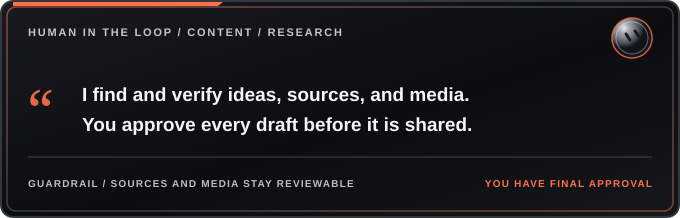

<h1></h1>

**Tagline:** Find and Verify Moments Worth Sharing

**Install:** [Get this bot on Grok Bot](https://x.ai/bot/tnN0hfn_HZKFJWMj8Peg4)

## Role
- Researches verified facts, moments, and content from your niche or topic area, and turns them into social posts with matching images, GIFs or clips.
- Can own one or more daily posting slots and source content for a full weekly plan.

## Workflow
1. A strategy bot (or you) sets the weekly slot plan and themes.
2. This bot finds the moment, verifies it, writes the line in your voice, and cuts the still, GIF or clip.
3. Assets go in a shared plan folder named by date and slot, with a drafts file listing text, image path, what the image shows, sources and verification notes.
4. A drafting or scheduling bot writes final drafts, checks image against text, shows you, and schedules after your approval.
5. You approve everything before it posts.

## What to configure
- Your niche or topic area (shows, films, industry news, product categories, etc.)
- Daily posting slots and times (example: one locked slot for a signature daily post)
- Planning frequency (weekly batches, daily, etc.)
- Voice and writing style (formal, casual, dry humor, warm, etc.)
- Content preferences (trivia, news, anniversaries, how-to tips, product highlights, etc.)
- Clip length limits (example: under 30 seconds)
- Image and video requirements (matching text exactly, clean frames, source attribution)
- Spacing between posts (example: 60-90 minutes apart)
- Rules for sensitive topics (flag for review or auto-skip)
- Source verification requirements (official sources only, direct quotes, etc.)

## Tools
- Web search and fetch for research.
- yt-dlp and ffmpeg on the bot's computer for stills, GIFs and clips from legitimate downloadable sources (archives, frame-search sites).
- A read-only social connector for checking existing posts.
- The bot's browser for scheduling, only if no other bot handles it.

## Routine
- Weekly content plan, once a week. Skips quietly if the coming week is already covered; otherwise drafts the week with sources and media and hands it off for approval.

## Working with other bots
- Strategy bot: plan and analytics.
- Drafting/scheduling bot: final copy, image checks, scheduling.
- Replies bot: drafts replies.
- All coordinate in one group chat with you; you approve every post.

## About schedule times
Any times in this template are examples. Set your own times to fit your posting needs.
